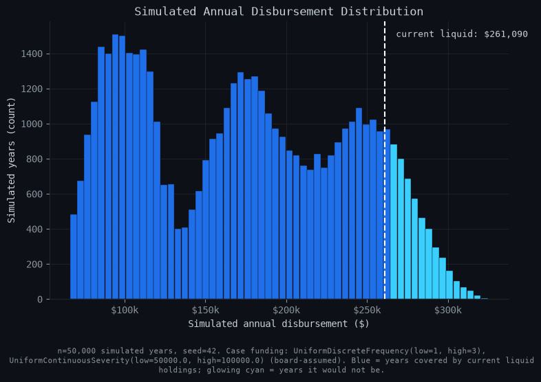

# Fortune

This tool sizes the cash reserve for a legal-aid non-profit, and recommends how to split what's left over across cash, fixed income and equity.

It's built and validated on the organisation's real banking data, and cross-checked against a decade of the organisation's own historical records (board minutes, past budgets, case funding history). None of that is in this repo; `data/` is a synthetic copy of the banking data, same structure.

This tool currently has the following features:

- Three-mechanism Monte Carlo engine (baseline + case funding + bootstrapped tail)
- Transaction classifier that strips out internal transfers and bounced payments
- Confidence intervals on thin-sample tail estimates
- Simple cash / fixed income / equity split for holdings above the reserve floor, with a check that flags drift from target weights
- Seeded, reproducible runs from a CLI
- Figures, regenerable on demand
- Full test suite against analytic ground truth

Future features that I would like to include:

- Net cash flow modelling, tracking inflows as well as outflows
- Re-estimate case funding once more real events accrue (board-assumed off n=1 right now)
- Use real return/risk data (Black-Litterman, Ledoit-Wolf) to optimise the allocation split instead of a fixed target
- Web UI instead of CLI
- LLM-drafted board memo
- Full board packet as one document

## Services Used

- Language - [Python](https://www.python.org)
- Monte Carlo Sampling - [NumPy](https://numpy.org)
- Transaction Loading - [pandas](https://pandas.pydata.org)
- Ground-Truth Stats - [SciPy](https://scipy.org)
- Figures - [Matplotlib](https://matplotlib.org)
- Tests - [pytest](https://docs.pytest.org)
- Helpful Partner - [Claude](https://claude.ai)

## Dataset

Two bank accounts, chequing and savings.

Real data withheld. `scripts/generate_sample_data.py` builds a synthetic sample with the same edge cases.

TODO: generator doesn't model inflows yet.

## Simulate

Use `simulate.py` to:

- Bucket every transaction (`classify.py`)
- Model the baseline, case funding and tail (`baseline.py`, `case_funding.py`, `tail.py`)
- Run 50,000 simulated years against current liquid holdings
- Recommend a cash / fixed income / equity split for anything above that (`allocation.py`)

## Results



On the real data, current reserves cover about 18% of simulated years, short about $199K at the 99th percentile ($315K needed). The gap is real, not a modelling artefact — recent case funding and new rent costs have pulled liquid holdings down. With holdings short of the floor, there's nothing yet to allocate; the cash / fixed income / equity split only kicks in once the floor is met. Figure above is from the synthetic sample.

## Run it

```bash
pip install -r requirements.txt
python -m fortune.cli --data data/ --seed 42 --figures
pytest
```

Against real data: fill in `local_config.example.json` and pass it with `--overrides-json`.
